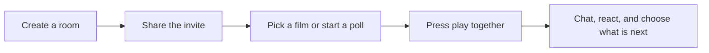
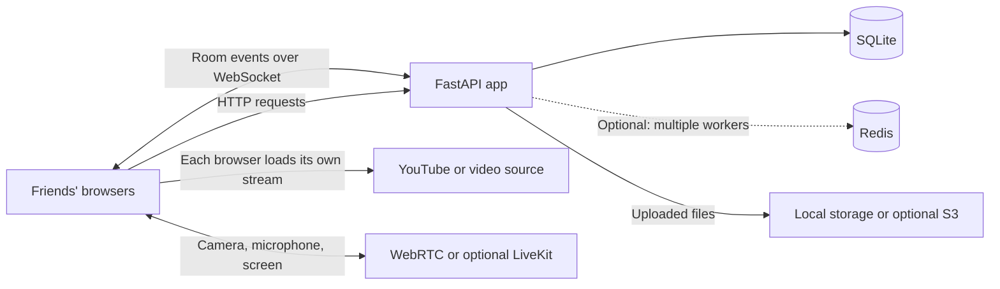

# Watch Party

Pick a film, invite your friends, and watch together in sync.

**Live demo:** [watch-party-4sas.onrender.com](https://watch-party-4sas.onrender.com/)

## A movie night, in four steps



## What you can do

- Browse a starter film collection, search titles, and add picks to the room queue.
- Share a room link or six-character code.
- Vote on the next film, chat, and send quick reactions or stickers.
- Watch from a YouTube link, a direct MP4/WebM URL, an uploaded file, or an embeddable page.
- Share a screen or join a video call while watching.

Playback is synchronized with room controls and timestamps. Each viewer's browser loads the movie from its source; Watch Party does not relay YouTube or streaming-service video. Some sites block embedding. For those, use screen sharing when the site permits it.

## How it is built



The server coordinates rooms, chat, and playback commands. It does not carry the movie stream. Redis is only needed when running multiple workers on the same machine. LiveKit is optional and carries camera or screen-share media.

## Run it locally

You need Python 3.10 or newer.

```powershell
python -m venv .venv
.\.venv\Scripts\Activate.ps1
pip install -r requirements.txt
python -m uvicorn app:app --reload
```

Open [http://127.0.0.1:8000](http://127.0.0.1:8000). The app runs without API keys and includes a small starter catalog.

To get live posters, film details, and IMDb ratings, add `OMDB_API_KEY` to a private `.env` file and restart the server. For optional stickers, video calls, multi-worker room state, or cloud uploads, see [External services](docs/EXTERNAL_SERVICES_SETUP.md).

## Deploy

The repository includes a Render blueprint in [`render.yaml`](render.yaml). The live demo is [Watch Party on Render](https://watch-party-4sas.onrender.com/). Hosting behavior and availability depend on the Render service configuration.

For setup notes and storage considerations, see [Deployment](docs/DEPLOYMENT.md) and [Free deployment](docs/FREE_DEPLOYMENT.md).

## Project map

```text
app.py                  FastAPI routes, room state, accounts, and movie data
static/index.html       Page structure and dialogs
static/styles.css       Layout, responsive styles, and theme
static/app.js           Discover, rooms, playback, and chat
static/media.js         Video chat and screen sharing
static/icons.js         Inline SVG icons
docs/                   Setup, deployment, and streaming notes
scripts/benchmark.py    Local WebSocket measurement tool
```

For the playback model and its limits, see [Stream modes and latency](docs/STREAMING_AND_LATENCY.md).
