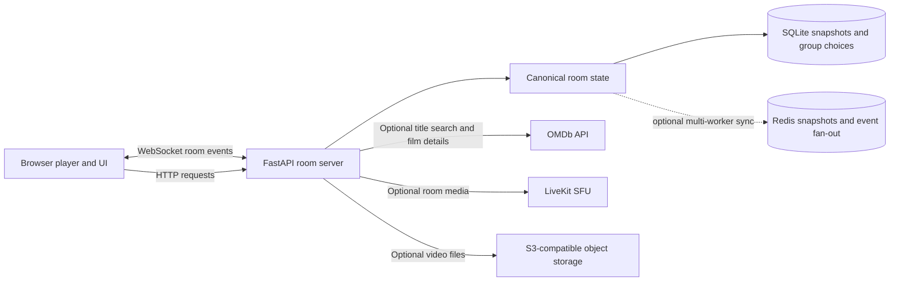

# Afterglow — Watch Party

Afterglow is a small watch-party app built to be easy to explain and extend. Friends discover a film, open a room, share an invite, and keep each browser's video player close to one shared playback clock.

## Run it locally

You need Python 3.10 or newer.

    python -m venv .venv
    .\.venv\Scripts\Activate.ps1
    pip install -r requirements.txt
    python -m uvicorn app:app --reload

Open [http://127.0.0.1:8000](http://127.0.0.1:8000).

The app works without an API key and shows 24 hand-picked films (18 at a time). To load real poster links, film details, and IMDb ratings, connect OMDb:

1. Open the [OMDb API key page](https://www.omdbapi.com/apikey.aspx), choose the free option, and enter the requested name, email, and usage information. The current form does not ask for a street or mailing address. Confirm the email if OMDb sends an activation link.
2. Open the existing `.env` file in a text editor. If it does not exist, create a file named `.env` in the project folder.
3. Add `OMDB_API_KEY=your_key_here`. Replace the example text with your key, without quotes, and do not share it in chat.
4. Refresh the browser. The updated server reads `.env` when the catalog loads. If the server was already running before this code update, restart it once (`Ctrl+C`, then `python -m uvicorn app:app --reload`) so it loads the updated code. The catalog status should say OMDb posters and IMDb ratings.

The key stays in the Python server and is not sent to the browser. The local .env file is private and excluded from version control. The free OMDb key is limited to 1,000 requests per day. The app caches movie details and searches in SQLite for 12 hours to reduce repeat requests. Its browse page uses a curated set because OMDb provides title search rather than a trending/discovery feed. See [OMDb's API page](https://www.omdbapi.com/) and [key request page](https://www.omdbapi.com/apikey.aspx) for current details.

### Live stickers from KLIPY

1. Create a KLIPY app in the [KLIPY Partner Panel](https://partner.klipy.com/) and copy its app key.
2. Add `KLIPY_APP_KEY=your_key_here` to your private `.env` file, or add `KLIPY_APP_KEY` in your host's environment settings (for example, Render). Do not paste the key into chat or commit it.
3. Restart the local server or redeploy. In a room, open the smile button, choose **Stickers**, and search KLIPY or tap a movie-night search suggestion.

KLIPY's browser API requires the app key in client requests, so it is visible in the browser's network tools; it is not a password or a server secret. Use any domain restrictions available in the KLIPY Partner Panel. Stickers load directly from KLIPY and show provider credit in the picker and chat. They are not copied into this app's storage. See [KLIPY's sticker API documentation](https://docs.klipy.com/stickers-api) and [API terms](https://klipy.com/support/api-terms) for current limits and usage rules.

KLIPY testing keys are limited to 100 API requests per hour. Request production access through the Partner Panel if the project needs a higher limit.

YouTube playback uses Google's embedded player rather than the YouTube search API, so a YouTube API key is not needed for pasted links. Camera and screen sharing use browser media permissions and WebRTC. The local demo works without a paid service. For the combined LiveKit Cloud, Upstash Redis, and Cloudflare R2 setup, follow [the external services guide](docs/EXTERNAL_SERVICES_SETUP.md). The app never pretends those services are active when they are not configured.

OMDb attribution appears below the catalog when provider data is in use.

## How to try it

1. Choose **Try sample** to open a room with the sample YouTube video, or choose **Start a room** to create an empty screening room.
2. Use **Invite** to copy the room URL. A second browser or device can join with the link or six-character code.
3. Open **Choose a stream** to add a YouTube link, a direct MP4/WebM URL, upload a video, or load a webpage that permits embedding.
4. Try **Share screen** for a live tab/window/desktop or **Join video chat** for camera and microphone. Grant browser permission when asked. These real-time features require HTTPS or localhost.
5. The host controls supported play, pause, and seek. The room also has chat, quick emoji reactions, a shared playlist, polls, and host transfer.
6. Open the profile button to keep the generated guest identity or create/sign in to an account. Accounts are optional for joining and are stored on this server.
7. In chat, type a colon and a few letters (for example, `:po`) to get emoji suggestions, or open the smile button. The **Stickers** tab searches KLIPY's live sticker library; everyone in the room loads each shared sticker from KLIPY.

The `Ctrl + K` hint beside Discover search means hold Control and press K to jump to the movie search box.

The catalog and the movie stream are separate. OMDb supplies film metadata and poster links; it does not provide the video stream. The demo uses the sample [YouTube video](https://youtu.be/yVndvvCdvU4?si=L0iOdFUS68nKxjS6) to try synchronized playback. Links to streaming-service pages are not direct video files and will not play in this player. YouTube works through its official embedded player when a video allows embedding. The webpage option is a regular iframe; it is not a cloud-hosted browser. Screen sharing is the fallback for pages that allow the sharer to present them.

## Technology and flow

- **Frontend:** HTML, CSS, and browser JavaScript. No front-end framework or build step.
- **Backend:** Python and FastAPI. Normal HTTP routes create rooms and retrieve movie data; a WebSocket carries live room actions.
- **Identity:** The server issues an HTTP-only session cookie. Guest mode is automatic; optional accounts use a salted scrypt password hash. Room control and uploads use the session identity rather than a browser-supplied user ID.
- **Storage:** SQLite stores users, sessions, room snapshots, recent movie data, and poll choices. Optional Redis shares room snapshots, locks, signaling, and WebSocket fan-out across multiple workers on one machine. Active WebSocket connections stay in each worker.
- **Live media:** The browser uses WebRTC for camera/microphone and screen sharing. Small rooms use a peer mesh with STUN and optional short-lived TURN credentials. Configure LiveKit to use an SFU for larger calls. The FastAPI WebSocket carries room controls and mesh signaling, never movie frames.
- **Uploads:** MP4/WebM files are stored in local `uploads/` by default and served with HTTP byte-range support. Optional private S3-compatible storage uploads the file then serves it through short-lived presigned links.

The server is the source of truth for the room. A play event contains a position and server timestamp. Each browser estimates the current shared position from those values. HTML5 video seeks when drift exceeds 500 ms. YouTube uses a wider 1.5-second tolerance to avoid disruptive seeks; if it makes no buffering progress for ten seconds, the app tries one gentle resume and then waits instead of retrying in a loop. A new participant receives a full room snapshot when they join.

See [docs/STREAMING_AND_LATENCY.md](docs/STREAMING_AND_LATENCY.md) for each source's media path, the latency correction design, WebRTC/TURN requirements, measurement limits, and the cloud-browser distinction.

## Put it online

For a free public demo deployment, follow [docs/FREE_DEPLOYMENT.md](docs/FREE_DEPLOYMENT.md). The free host sleeps when idle and its temporary filesystem means SQLite accounts and room data reset after restarts; the guide explains these limits before you share the link.

Concurrent room events are processed one at a time under a local per-room lock, plus a Redis distributed lock when multi-worker mode is enabled. Each update gets a version number, and action IDs make a retried action safe to ignore. Host-only playback controls and uploads are checked against the server session, not a user ID in the request. If a host disconnects while other people are online, the server transfers host controls to the earliest connected participant.

## Recommendations

The app has 24 curated starter films. With an OMDb key, it enriches those films with poster links, plot, runtime, genres, IMDb rating, and IMDb vote counts. Typed searches use OMDb's title search, then fuzzy matching can still find close title spellings in search results and the curated set. Genre filters work on the returned genres. “Highest rated” sorts by IMDb rating; “Popular” uses IMDb vote counts. OMDb does not provide a trending feed, so the browse set is curated instead of being presented as live trending data.

The app stores group poll choices in SQLite. Positive votes add weight to the genres selected by the group; the catalog then ranks films with matching genres and explains why each one appears. Each title links to its IMDb page when an IMDb ID is available, or a title search otherwise, and to a Moctale-specific web search.

IMDb scores shown in the catalog are the ratings returned by OMDb; the IMDb links open the original IMDb title page. Moctale remains an external title-specific search because this project has not found a public developer API for its recommendation data. The app does not claim to import Moctale's lists.

OMDb says it is not affiliated with IMDb. Its API is described as noncommercial and its data as CC BY-NC 4.0; this project displays provider attribution and is intended as a student/demo project. Review the current [OMDb terms and key options](https://www.omdbapi.com/) before using the data commercially.

## Interview walkthrough

1. Show that the frontend is just semantic HTML, component-style CSS classes, and ordinary JavaScript.
2. Open the profile dialog and explain that a server-issued guest session is automatic, with optional username/password accounts.
3. Create a room and point to the room-creation route.
4. Open the invite in a second browser and show the WebSocket presence update.
5. Play, pause, or seek, then explain that the server broadcasts a timestamped shared position.
6. Add two films, create a poll, and vote. Show how poll votes become group preference data.
7. Transfer host to another connected person and explain why authorization is checked by the server.
8. Show the performance notes for the local measurement method, results, and limits.

This is a working interview/demo project, not a finished internet-scale service. Run one Uvicorn worker for the no-service local setup. Optional Redis coordinates multiple workers on one machine when they share the same local SQLite file; multi-host deployment still needs a shared transactional database. Configure and verify a TURN/SFU service and object storage before relying on group calls or uploads over the public internet. The 14.09 ms p95 result is historical control-message data and has not been rerun after the authentication and Redis changes.
