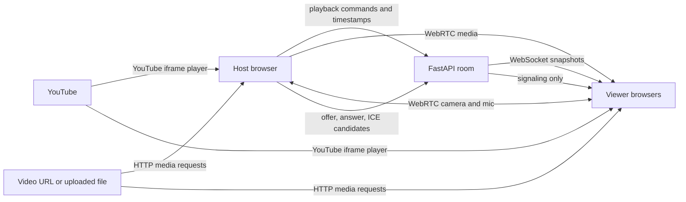

# Stream modes and latency

Watch Party sends room commands separately from audio and video. The FastAPI WebSocket carries small events such as `play`, `pause`, `seek`, chat, and WebRTC setup messages. It does not proxy YouTube or ordinary movie frames.

## What each mode sends

| Mode | Media path | What the room synchronizes | Limits |
| --- | --- | --- | --- |
| YouTube | Each browser loads the official YouTube IFrame player. | Host play, pause, and seek commands, plus a shared position. | The video must allow embedding and be available in each viewer's region. The embed player is not a movie-rights bypass. |
| Direct URL | Each browser's `<video>` downloads from the supplied MP4/WebM URL. | The media URL and playback clock. | Every viewer must be able to reach the URL; the source should support byte-range requests for efficient seeking. |
| Uploaded file | Each viewer streams the MP4/WebM from `/media/...`. | The app URL and playback clock. | 3 GB cap. Files use local disk by default; optional private S3-compatible storage can hold them off-machine. The app server still issues the media link, but large deployments should serve through storage/CDN infrastructure. |
| Embedded webpage | A sandboxed iframe loads the same page URL on each device. | The page URL only. | Page controls and cookies are not synchronized. Many sites block frames with `X-Frame-Options` or Content Security Policy. This is an embedded page, not a cloud browser. |
| Screen share | The selected screen/tab is captured by the sharer's browser and sent to viewers over WebRTC. | Who is sharing; the live media itself. | Requires HTTPS or localhost and browser permission. Tab audio availability depends on what the browser lets the user select. DRM-protected streams may appear black. |
| Video chat | WebRTC peer mesh by default; optional LiveKit SFU when configured. | Who joined the call; mesh offer/answer and ICE signaling, or a short-lived LiveKit room token. | Mesh is for small rooms. LiveKit forwards one published stream to subscribers; a provider/server is required. Optional coturn credentials provide relay paths where direct connections fail. |

For a true cloud virtual browser, the next deployment needs a remote Chromium session per room, a WebRTC or VNC media gateway, and a way to send keyboard/mouse input back to that session. This project does not launch remote browsers or store third-party site logins. The available browser-page mode is deliberately labeled as an embedded page so it does not imply those capabilities.

## How playback drift is corrected

1. The server records the canonical media position, play/pause state, and server timestamp.
2. Browsers estimate server clock offset with a ping/pong every five seconds. A late joiner gets a room snapshot and calculates the position it should be at now.
3. For regular HTML5 video, the browser compares local time with the shared clock every 500 ms and seeks when drift exceeds 500 ms.
4. YouTube is treated more gently: while its player reports `BUFFERING`, the app does not seek. If buffering makes no progress for ten seconds, it sends one `playVideo()` resume nudge, then waits instead of retrying in a loop. The app checks the IFrame API's buffered fraction and playback time to detect progress. During normal playback, it only seeks after drift exceeds 1.5 seconds and at most once every five seconds. This reduces sync-induced interruptions; it cannot make a slow network or YouTube CDN deliver data faster. YouTube's IFrame API no longer supports programmatically forcing playback quality, so the viewer can use the player's own Quality menu when available.
5. WebRTC media uses the browser's real-time transport and jitter buffers. It is a live stream rather than a seekable movie; network congestion can increase video delay or lower quality.

Control-message latency and video startup latency are different measurements. A previous benchmark delivered 270 WebSocket control-message observations between ten clients on one computer at **14.09 ms p95**. This is a historical loopback result from before the session-auth and optional Redis changes; it has not been rerun against the current code. It measures room-event propagation only. It does not measure Wi-Fi, the public internet, YouTube buffering, uploaded-file startup, WebRTC glass-to-glass delay, or camera quality. Run the benchmark from another computer on the target local network for a LAN result. The 250 ms p95 requirement and post-correction 500 ms drift requirement need fresh measurements with the actual network, browsers, and supported media.

## Network plan for a real deployment

- Keep the timestamped room state on the server; use monotonic client timers between snapshots and correct only after meaningful drift.
- Let a CDN or source provider distribute the large media bytes. Do not push movie files through the WebSocket.
- The default peer-mesh media path uses public STUN. If `TURN_URLS` and `TURN_SHARED_SECRET` are configured, the server gives each signed-in user short-lived coturn REST credentials for restrictive NATs/firewalls. LiveKit Cloud manages TURN for its SFU calls, so a separate coturn server is unnecessary in that mode.
- If all `LIVEKIT_URL`, `LIVEKIT_API_KEY`, and `LIVEKIT_API_SECRET` settings are configured, group camera/screen calls use LiveKit's SFU. Each participant publishes once and the SFU forwards to subscribers. Otherwise the app uses the small-room mesh. Neither setting changes the source of movie playback.
- The no-service default uses one FastAPI worker. With REDIS_URL, workers on one machine share room snapshots, distributed room locks, WebSocket event fan-out, and mesh signaling; all workers must still use the same SQLite file for sessions and votes. This mode has not yet been benchmarked. Multi-host deployment needs a shared transactional database and object storage. See [DEPLOYMENT.md](DEPLOYMENT.md) for the exact boundary.

## Failure behavior

- A failed media URL leaves room chat and controls online; the player shows an unavailable state.
- YouTube's player can reject a video when embedding is disabled, age/region rules apply, or the network blocks YouTube.
- The iframe cannot detect or work around a site's frame policy. Use screen sharing for a page that the sharer is permitted to show.
- Uploads reject files outside MP4/WebM and files larger than 3 GB. They use local disk by default; S3 mode uses private objects and short-lived presigned links. A production rollout still needs quotas, cleanup, backups, and storage monitoring.
- If peer media cannot connect, room playback/chat still work. Configure and test TURN or LiveKit on the networks where calls will be used.
- Account records and sessions are stored in SQLite. Sign-in and account-creation attempts have basic per-IP limits, but there is no password recovery, email verification, or MFA.

## References

- [YouTube IFrame Player API](https://developers.google.com/youtube/iframe_api_reference)
- [Screen Capture API: `getDisplayMedia()`](https://developer.mozilla.org/en-US/docs/Web/API/MediaDevices/getDisplayMedia)
- [WebRTC perfect negotiation](https://developer.mozilla.org/en-US/docs/Web/API/WebRTC_API/Perfect_negotiation)
- [WebRTC peer connections and signaling](https://webrtc.org/getting-started/peer-connections)
- [WebRTC TURN servers](https://webrtc.org/getting-started/turn-server)
- [coturn REST/shared-secret configuration](https://github.com/coturn/coturn/blob/master/examples/etc/turnserver.conf)
- [LiveKit tokens and grants](https://docs.livekit.io/home/server/generating-tokens)
- [Starlette file responses and byte ranges](https://www.starlette.io/responses/)
- [Content Security Policy `frame-ancestors`](https://developer.mozilla.org/en-US/docs/Web/HTTP/Reference/Headers/Content-Security-Policy/frame-ancestors)
- [LiveKit's SFU explanation for scaling group media](https://docs.livekit.io/reference/internals/livekit-sfu/)
